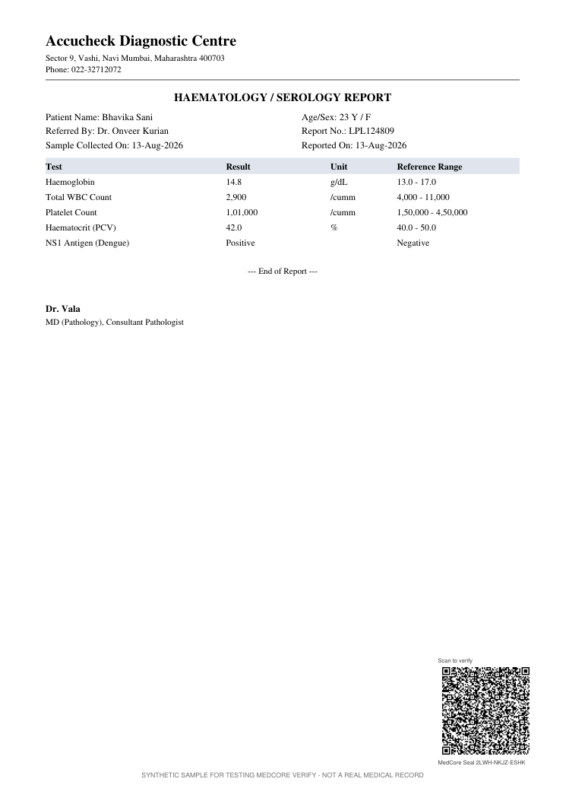
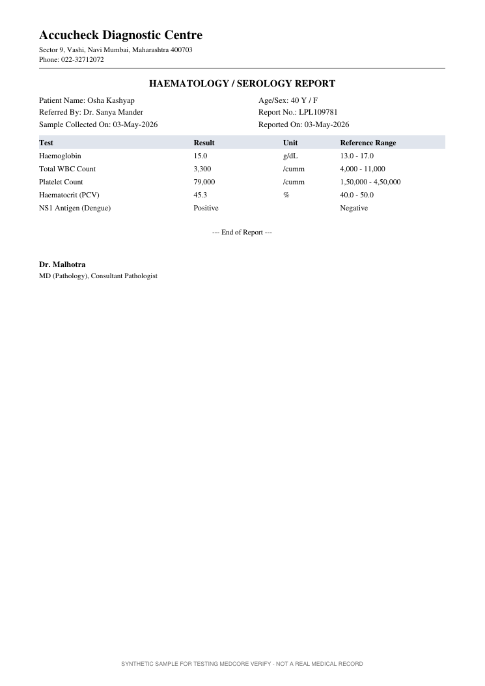

# MedCore: the beginner's guide, code walkthrough and demo script

Read this once from top to bottom. By the end you will know what the project does, what each screen is for, what goes in and what comes out, what every important file in the code does, and exactly what to click and say in front of your teachers.

---

## 1. The project in one paragraph

Health insurance claims arrive as a bundle of documents: a discharge summary, a hospital bill, lab reports and a pharmacy bill. People fake or edit these to get money they are not owed. **MedCore fights this in two layers.**

- **Prevent:** the hospital or lab installs MedCore, and every document it makes gets a **QR seal**. The seal is a QR code holding the document's key facts and a digital signature that only that hospital can create.
- **Detect:** when a claim reaches the insurer, MedCore checks every seal against the printed page. It then runs three content checks on every document, sealed or not.

## 2. Words you need to know

| Word | Meaning |
| --- | --- |
| Claim / claim file | A request to an insurer to pay for a hospital stay, and the documents sent with it. |
| Discharge summary, hospital bill, lab report, pharmacy bill | The four document types this version reads. |
| QR seal | A QR code stamped on the page. It holds the document's key facts (patient, dates, test values, total) and a signature. |
| Digital signature | Maths that proves who created something. Only the holder of the **private key** can make it. Anyone with the matching **public key** can check it. |
| Private key / public key | A matched pair. The hospital keeps the private key secret and uses it to sign. The public key sits in the registry so everyone can verify. |
| Registry | The list of hospitals, labs and pharmacies allowed to seal, with their public keys. |
| Public log | A record of every seal ever made. Each entry contains the previous entry's hash, so changing or deleting any entry is detected. It holds no patient data. |
| Revoke | A hospital cancelling a seal it issued by mistake. Verification then reports it as revoked. |
| Hospital stay number | The admission number (for example IPD/26/66701). It is written into the seal of every document from one stay. |
| Flag / problem | One contradiction MedCore found: Serious, Check or Minor. |
| Verdict | Hold for review, Probably fine with notes, or No problems found. A flag means "check this", never "fraud". |

## 3. The four screens

| # | Screen | Who uses it | What it does | Main code |
| --- | --- | --- | --- | --- |
| 1 | **Issue** | Hospital or lab | Seals a PDF: reads it, signs its facts, stamps the QR code, writes the log | `seal/service.py` `seal_pdf()` |
| 2 | **Verify** | Anyone: employer, pharmacist, insurer | Checks one document's seal against the page and shows each check passing or failing | `seal/service.py` `check_seal()` |
| 3 | **Claim check** | Insurance claim officer | Checks a whole claim: seals, then the three content checks | `pipeline.py` `analyze()` |
| 4 | **Registry and log** | Administrator | Lists who may seal, registers new issuers, shows the public log, revokes seals, shows alerts | `seal/registry.py` `Registry` |

## 4. What goes in: the demo files

Everything is synthetic, made by the project's generator, and marked "SYNTHETIC SAMPLE" at the bottom of every page.

```
demo/
  DEMO_GUIDE.md                      <- this file
  claims/                            <- claim files for screen 3 (Claim check)
    01_genuine_dengue/               genuine, not sealed
    02_edited_lab_value_dengue/      a lab value changed (re-printed cleanly)
    03_upgraded_diagnosis_typhoid/   typhoid relabelled as dengue
    04_painted_over_total_appendicitis/  bill total painted over inside the PDF
    05_padded_room_days_typhoid/     extra room days billed
    06_tripled_pharmacy_qty_dengue/  medicine quantities tripled (not caught yet)
    07_sealed_genuine_dengue/        genuine, every document sealed
    08_sealed_then_edited_dengue/    sealed, then the lab report edited and the real QR copied on
    09_borrowed_sealed_report_typhoid/  a genuine sealed lab report from another patient's stay
      (each folder: the PDFs, ABOUT.md explaining it, truth.json with the answer)
  verify/                            <- single documents for screen 2 (Verify), with ABOUT.md
    1_genuine_sealed_lab_report.pdf
    2_edited_after_sealing.pdf
    3_fake_qr_unregistered_lab.pdf
    4_stolen_key_never_logged.pdf
    5_unsealed_lab_report.pdf
  keys/                              <- demo issuers, their demo keys, the log of demo seals
  pictures/                          <- a picture of every page, for slides
```

A sealed document has its QR code in the bottom-right corner:

| Sealed lab report | Unsealed lab report |
| --- | --- |
|  |  |

## 5. What comes out

- **Issue:** the sealed PDF to download, its seal ID (for example `Y4J3-6EYC-WKLD`), the QR code, and the list of facts the seal signs.
- **Verify:** a coloured verdict (Genuine, Altered after sealing, Sealed by an unregistered issuer, Seal is not in the public log, Seal was revoked, No seal), then:
  - the six checks in order, each with a tick or a cross;
  - who issued the document;
  - a table of every signed fact against what is printed.
- **Claim check:** a verdict for the whole claim, the three checks, and every problem with its evidence. Each document shows a seal badge.
- **Registry and log:** the issuers, whether the log is intact, issuing alerts, and every log entry, with a Revoke button.

## 6. How it works inside: the code walkthrough

The backend is Python (FastAPI); the screens are React. Paths are under `backend/medcore_verify/` unless they start with `frontend/`.

### 6.1 Reading a document (used by every screen)

| File | What it does | Key functions |
| --- | --- | --- |
| `reading/loader.py` | Opens a PDF (or an image, through Tesseract OCR) and rebuilds its text line by line, keeping table columns apart. It also notices text printed on top of other text. | `load()`, `_to_lines()`, `_drop_overprinted()` |
| `reading/extract.py` | Works out the document type and pulls out the fields: patient, age, sex, dates, doctor, diagnosis, tests, bill lines, totals, and the lab values a discharge summary quotes. | `classify()`, `extract()`, `_read_tests()`, `_quoted_values()` |
| `models.py` | The shapes of the data (`ExtractedDoc`, `Flag`, `Report`) and the verdict rule. | `decide_verdict()` |

### 6.2 Sealing (screen 1)

| File | What it does | Key functions |
| --- | --- | --- |
| `seal/facts.py` | Chooses which facts to sign for each document type, and makes a fingerprint (hash) of all the text on the page. | `facts()`, `text_fingerprint()` |
| `seal/crypto.py` | Ed25519 signatures. Packs the facts into a short token (`MCS1.<facts>.<signature>`) and reads it back. Stores private keys. | `sign_token()`, `parse_token()`, `signature_valid()`, `KeyStore` |
| `seal/qr.py` | Draws the QR code onto the PDF, and finds QR codes again in PDFs, scans and photos (zxing-cpp, with OpenCV as backup). | `stamp()`, `find_tokens()` |
| `seal/service.py` | Puts it together: check the issuer is active and its key matches the registry; read the PDF; sign; stamp; write the log entry. | `seal_pdf()` |

### 6.3 Verifying (screen 2)

`seal/service.py` `check_seal()` runs six steps and stops at the first failure:

1. Find a MedCore QR code on the page. If there isn't one: "No seal".
2. Look up the issuer in the registry. If it isn't there: "Sealed by an unregistered issuer".
3. Check the signature with the issuer's public key. If it fails: "Seal signature is invalid".
4. Find the seal in the public log. If it's missing: "Not in the public log", which means a possibly stolen key.
5. Check for a revocation. If there is one: "Seal was revoked".
6. Compare every signed fact, and the page fingerprint, with the page as printed now. If anything differs: "Altered after sealing". Otherwise: "Genuine".

### 6.4 The registry and the public log (screen 4)

`seal/registry.py` stores issuers and log entries (tables defined in `db.py`).
- `append()` adds an entry whose hash covers the previous entry's hash.
- `verify_chain()` recomputes every hash, so an edited or deleted entry shows up.
- `revoke()` records a revocation.
- `alerts()` flags an issuer that seals more than 25 documents in one hour.

### 6.5 Checking a claim (screen 3)

`pipeline.py` `analyze()` reads every document, checks each seal, then runs three checkers:

| File | Check | What it looks for |
| --- | --- | --- |
| `seal/service.py` `seal_flags()` | Part of check 1, plus check 2 | Broken seals; sealed documents from different hospital stays |
| `checks/forensics.py` | 1. Seals and editing signs | Text painted over in a PDF, extra save layers, PDF editing tools |
| `checks/agreement.py` | 2. Documents agree | Names, ages, sex, dates, totals, room days, quoted lab values, hospital, doctor's registration |
| `checks/medical.py` + `checks/knowledge.json` | 3. Medicine fits | Confirming test present and positive, low platelets shown, repeat tests, stay length, drugs to avoid, surgery charges |

### 6.6 The API and the screens

- `api.py` has one group of endpoints per screen: `/api/seal`, `/api/verify`, `/api/checks`, `/api/issuers` and `/api/log`. It also serves the built web app.
- `frontend/src/App.tsx` is the tab bar. `frontend/src/screens/` holds one file per screen. `frontend/src/api.ts` holds every call to the backend, with types.

### 6.7 Test data and tests

- `datagen/` makes the synthetic documents and the forgeries. `datagen/demo.py` builds this whole demo folder.
- `evaluation.py` scores the checkers on 390 generated claims.
- `backend/tests/` has 91 tests covering:
  - every forgery and seal attack;
  - log tampering;
  - QR reliability;
  - every API endpoint and the security rules.

## 7. How to run it

You need Python 3.11+ and Node.js 22+. Tesseract OCR is optional; it is only needed to read photos and scans.

```bash
cd medcore-verify
python3 -m venv .venv
source .venv/bin/activate          # Windows: .venv\Scripts\activate
pip install -e "backend[dev]"
cd frontend && npm install && npm run build && cd ..
uvicorn medcore_verify.api:app --app-dir backend --port 8000
```

Open **http://localhost:8000**. Run `cd backend && pytest` before the demo: 91 tests should pass.

To start the demo from a clean state, stop the server, delete the `data/` folder, and start it again. The demo issuers and demo seals load automatically.

## 8. The demo script (about 8 minutes)

1. **The problem (30 seconds).** "Insurers in India lose an estimated 8,000 to 10,000 crore rupees a year to claim fraud. Forged documents look exactly like real ones, and AI editing makes them easier to make. So we built two layers: seal documents at the source, and check every claim."

2. **Screen 4, Registry (30 seconds).** Show the list. "Only these registered hospitals, labs and pharmacies can make a valid seal. The registry holds their public keys."

3. **Screen 1, Issue (1 minute).**
   - Pick *Accucheck Diagnostic Centre*.
   - Pick the demo document *Genuine claim: lab_report_1.pdf*.
   - Type stay number `IPD/26/66701` and click **Seal document**.

   Say: "The lab's software would do this automatically for every report. MedCore read the report, signed these facts with the lab's private key, and stamped this QR code. It also wrote the seal into the public log."

4. **Screen 2, Verify (2 minutes).** Click each demo document:
   - **Genuine sealed lab report:** all six checks pass.
   - **Edited after sealing:** "Someone changed the platelet count and copied the real QR code onto the edited page. The QR code is genuine, so a phone camera would accept it, but MedCore compares it with the page and catches the difference." Point at the red row in the table.
   - **Fake QR, unregistered lab:** "Anyone can print a QR code. Only registered labs can sign one."
   - **Stolen key, never logged:** "This one is signed with a real lab's key, as if the key were stolen. But every genuine seal is logged the moment it is made, and this one never was."
   - **Unsealed lab report:** "Most hospitals will not seal for years, which is why we have screen 3."

5. **Screen 4 again, revoke (1 minute).** Find the seal you made in step 3 at the top of the log. Click **Revoke**, type "Issued for the wrong patient" and click **Confirm**. Say: "The log is still intact. Every entry is chained to the one before, so nobody can quietly delete a seal."

6. **Screen 3, Claim check (3 minutes).**
   - **Genuine claim:** passes.
   - **Lab value edited:** "No seal here, but the discharge summary still quotes the original value."
   - **Diagnosis upgraded:** "Medicine check: dengue needs a dengue test and low platelets."
   - **Bill total painted over:** "The hidden original number is still inside the PDF."
   - **Sealed genuine claim:** every document has a valid seal badge.
   - **Sealed report from another stay:** "Each seal names its hospital stay. This lab report is genuine, but from another patient's stay."
   - **Pharmacy quantities tripled:** "This one gets through. It's in our future scope." Saying this honestly is a strength.

7. **Results (30 seconds).** On 390 test claims there were 0 false alarms on genuine claims. On clean edits, editing signs alone caught 0% and the other two checks caught 86%. "These are our own test claims, so they show the system works, not real-world accuracy."

## 9. Built now vs future scope

| Built now | Future scope |
| --- | --- |
| Four screens: Issue, Verify, Claim check, Registry and log | A patient app that holds sealed documents |
| QR seals with Ed25519 signatures on PDFs; verification from PDFs, scans and photos | Sealing straight from hospital software (HMS plug-in); hardware key storage |
| Field-by-field and whole-page comparison | Sharing only some fields of a document (selective disclosure) |
| Stay binding, revocation, stolen-key detection through the public log | Signed revocations; publishing the log's latest hash every hour |
| Hash-chained public log with an integrity check; one alert rule (bursts) | More alert rules, for example one doctor signing for labs in many cities |
| Claim check: 3 diagnoses, 4 document types, 10 forgery variants tested | 10+ diagnoses, prescriptions, phone-photo forensics, real AI-edited forgeries |
| 91 automated tests; evaluation on 390 claims | A user study; logins and roles; deployment |

## 10. Questions your teachers may ask

**CoWIN and NABL already use QR codes. What's new?** CoWIN's QR code carries signed data, which a person then compares with the paper by eye. NABL's QR code links to the report online. Ours goes further:
- It compares the signed facts with the printed page, so a real QR pasted onto an edited page is caught.
- It ties all documents of one stay together.
- It logs every seal publicly, so a stolen key is caught.
- It adds a second layer, the three content checks, for documents without seals.

**What if someone copies a genuine QR code onto a fake document?** That's sample 2 on the Verify screen. The QR code is real, but the facts it signs no longer match the page, so MedCore shows "Altered".

**What if a hospital's private key is stolen?** That's sample 4. The thief can sign, but the seal is not in the public log, because the log is written when a seal is made through MedCore. Replacing a stolen key while keeping old seals valid (key rotation) is future scope.

**Why not blockchain?** Our public log already gives the property that matters: nobody can change or delete history without it being detected. It does this with a simple hash chain, without running a blockchain network. Publishing the log's latest hash on a public blockchain once an hour is future scope.

**Is patient data exposed?** The public log holds only IDs, document types and hashes. The QR code does contain the document's key facts, like the patient's name and results, as health certificates do. Hiding some of them (selective disclosure) is future scope.

**Is the data real?** No. All documents, hospitals and keys are synthetic, so no patient's privacy is at risk. It is also a limitation, and we say so.

**What if a forger changes every document consistently?** If the documents are sealed, the seals catch it. If they are not sealed, the three content checks may miss it. That is our main limitation, and the reason sealing matters.

## 11. Rebuilding the demo files

```bash
cd backend
python -m medcore_verify.datagen demo --out ../demo
```

Demo keys are kept between rebuilds, so a running server stays valid.
